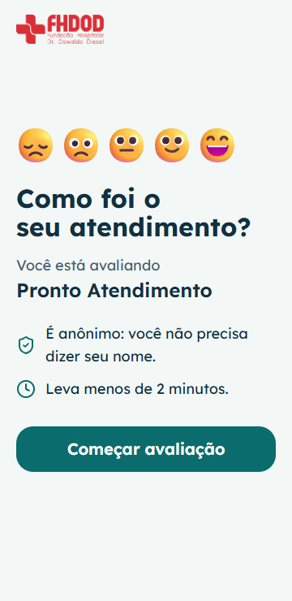
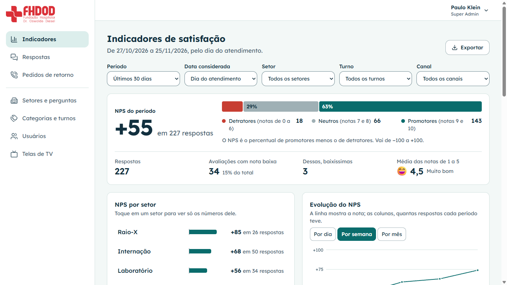
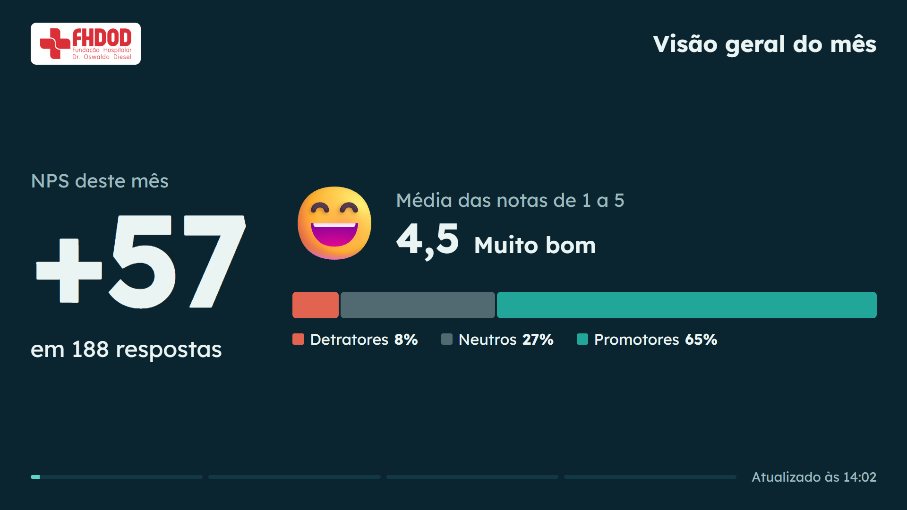
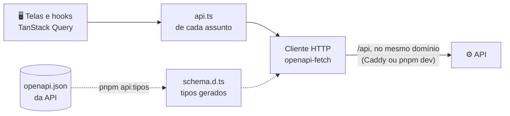

<div align="center">


<h1>Sistema de Satisfação Hospitalar · Front-end</h1>

<p><b>A pesquisa do paciente, o painel da gestão e a TV Wall da FHDOD.</b></p>

<p>


</p>

<p>
<a href="https://github.com/GabrielPittaBr/fhdod-satisfacao-web/actions/workflows/ci.yml"></a>
<a href="https://www.conventionalcommits.org/pt-br/"></a>
<a href="https://github.com/GabrielPittaBr/fhdod-satisfacao-api/tree/develop"></a>
</p>

<p>
<a href="#-sobre">Sobre</a> ·
<a href="#-como-funciona">Como funciona</a> ·
<a href="#-como-rodar">Como rodar</a> ·
<a href="#-imagem-docker">Imagem Docker</a> ·
<a href="#-documentação">Documentação</a>
</p>

</div>

---

## ✨ Sobre

O paciente avalia o atendimento pelo celular, lendo o QR Code do setor, ou pelo totem, sem login. A gestão acompanha os indicadores, as respostas e os pedidos de retorno no painel, e a TV da recepção mostra os números do mês. **Este repositório é o front-end**, um site estático em React; tudo o que ele mostra vem da [API](https://github.com/GabrielPittaBr/fhdod-satisfacao-api/tree/develop).

<table>
  <tr>
    <td align="center" rowspan="2">
      <br>
      <sub><b>📱 Pesquisa</b> no celular e no totem</sub>
    </td>
    <td align="center">
      <br>
      <sub><b>📊 Painel</b> da gestão</sub>
    </td>
  </tr>
  <tr>
    <td align="center">
      <br>
      <sub><b>📺 TV Wall</b> da recepção</sub>
    </td>
  </tr>
</table>

| | Área | Para quem | O que faz |
| :---: | --- | --- | --- |
| 📱 | **Pesquisa** | O paciente, no celular, no tablet e no totem | Os rostinhos de 1 a 5 e a nota de 0 a 10, com comentário e telefone para retorno opcionais. No totem, reinicia sozinha para o próximo paciente |
| 📊 | **Painel** | A gestão, no computador e no celular | Indicadores, respostas, pedidos de retorno, cadastros, usuários, telas de TV e exportações, com o menu de cada perfil |
| 📺 | **TV Wall** | A recepção, numa TV em tela cheia | Os números do mês, renovados a cada 30 segundos, sem nenhum dado pessoal |

## 🧭 Como funciona



- **Tudo vem da API.** O front não tem dados simulados: para ter o que mostrar, a API precisa estar no ar, de preferência com os dados de demonstração dela.
- **Quem decide é a API.** O front não calcula a classificação da nota, o NPS nem as permissões: só exibe o que chega pronto.
- **Os tipos vêm do contrato.** O `pnpm api:tipos` gera o `schema.d.ts` a partir do `openapi.json` da API, e o TypeScript confere cada chamada.
- **Nada da pesquisa fica no navegador**, nem a chave da avaliação: no totem, o próximo paciente não vê nada do anterior.

## 🚀 Como rodar

| Precisa de | Versão | Para conferir |
| --- | --- | --- |
| Node.js | 26 (fica no `.nvmrc`, a mesma da API) | `node --version` |
| pnpm | 12 (`npm install --global pnpm@12`, se não tiver) | `pnpm --version` |
| Docker | para o banco da API | `docker compose version` |

**1. Os dois repositórios lado a lado.** O front lê o contrato da API na pasta ao lado:

```bash
git clone -b develop https://github.com/GabrielPittaBr/fhdod-satisfacao-api.git
git clone -b develop https://github.com/GabrielPittaBr/fhdod-satisfacao-web.git
```

**2. A API, com os dados de demonstração.** Na pasta dela (o passo a passo completo está no [README da API](https://github.com/GabrielPittaBr/fhdod-satisfacao-api/blob/develop/README.md#-rodar-localmente)):

```bash
cd fhdod-satisfacao-api
pnpm install && cp .env.example .env
docker compose up -d                  # PostgreSQL de desenvolvimento e de teste
pnpm db:deploy && pnpm db:seed        # as tabelas, as categorias, os turnos e o Super Admin
DEMO_CONFIRM=satisfacao pnpm db:demo  # os dados de demonstração
pnpm dev                              # API em http://localhost:3333
```

**3. O front**, em outro terminal:

```bash
cd fhdod-satisfacao-web
pnpm install   # dependências e hooks do Git
pnpm dev       # front em http://localhost:5173
```

O `pnpm dev` repassa tudo o que começa com `/api` para a API em `http://localhost:3333`, como o Caddy faz no servidor: o front chama a API sempre no mesmo endereço do site, sem CORS no caminho.

> [!NOTE]
> No PowerShell, o `db:demo` é `$env:DEMO_CONFIRM='satisfacao'; pnpm db:demo; Remove-Item Env:DEMO_CONFIRM`. Com a API no ar, <http://localhost:3333/api/health> responde `{"data":{"status":"ok","banco":"ok"}}`.

### 🗺️ Endereços

| Endereço | O que abre |
| --- | --- |
| <http://localhost:5173/login> | O painel: entre com uma das contas abaixo |
| <http://localhost:5173/s/pronto-atendimento> | A pesquisa do setor, para onde o QR Code leva |
| <http://localhost:5173/totem/pronto-atendimento> | A mesma pesquisa no modo totem |
| <http://localhost:5173/tv#demo-recepcao-fhdod> | A TV Wall da tela de demonstração |
| `/tv#demo-corredor-desativada` | Uma tela desativada: mostra que a tela não está ativa |
| `/s/<setor>` de um setor desativado ou que não existe | A mensagem de pesquisa indisponível |

As contas de demonstração são as do README da API, uma de cada perfil. No primeiro acesso, o painel pede a troca da senha provisória antes de abrir.

| Conta | Perfil | Senha na sua máquina |
| --- | --- | --- |
| `admin@fhdod.example` | Super Admin | `admin-demo-2026` |
| `marta@fhdod.example` | Gestor do Pronto Atendimento e da Internação | `gestor-demo-2026` |
| `renata@fhdod.example` | Ouvidoria | `ouvidoria-demo-2026` |
| `diego@fhdod.example` | Visualizador do Raio-X | `leitura-demo-2026` |
| `luana@fhdod.example` | Gestor do Laboratório, no primeiro acesso | `provisoria-2026` |

<details>
<summary><b>🎭 Dados de demonstração</b></summary>

Os dados de demonstração ficam só na API: o front não tem nenhum. O `pnpm db:demo`, na pasta dela e depois do `pnpm db:seed`, grava no banco de lá:

- os 6 setores, com as perguntas de cada um na ordem da jornada (o `pronto-atendimento` abre os links acima; a Maternidade está desativada);
- uma conta de cada perfil, as da tabela acima;
- as duas telas de TV dos endereços acima;
- cerca de quatro meses de avaliações até hoje, com comentários e pedidos de retorno. Tudo é inventado.

O código fica em [`prisma/seeds/demonstracao/`](https://github.com/GabrielPittaBr/fhdod-satisfacao-api/tree/develop/prisma/seeds/demonstracao), no repositório da API. Rodar de novo substitui os dados de demonstração, sem duplicar nada, e gera as avaliações até a data de hoje. O comando nunca roda em produção; o README da API explica por quê.

</details>

<details>
<summary><b>🧩 Sem os dados de demonstração</b></summary>

Cadastre pelo próprio painel, com o Super Admin que o `pnpm db:seed` cria (o `SEED_ADMIN_EMAIL` e a senha provisória `SEED_ADMIN_PASSWORD` do `.env` da API), o que a pesquisa e os outros perfis precisam:

- para a pesquisa abrir, um setor com perguntas, em "Setores e perguntas". Com o endereço `pronto-atendimento`, os links acima abrem a pesquisa;
- para entrar com os outros perfis, os usuários, em "Usuários": a senha provisória aparece uma vez só, ao criar a conta ou ao redefinir a senha, com o botão de copiar;
- para o dashboard, as respostas, os pedidos de retorno e a TV terem o que mostrar, avaliações respondidas na pesquisa. O telefone para retorno é oferecido na avaliação baixa;
- para a TV, uma tela, em "Telas de TV": o link dela, com o token depois do `#`, aparece uma vez só, ao criar a tela.

</details>

<details>
<summary><b>🧯 Como ver as falhas</b></summary>

As falhas são as de verdade, sem simulação pela URL: pare a API ou deixe o navegador offline (DevTools › Network › Offline).

- **Com a API parada**, a pesquisa não abre e oferece "Tentar de novo".
- **Sem internet no meio da pesquisa**, as respostas continuam na tela, e a mesma chave vai na nova tentativa, sem gravar a avaliação duas vezes.
- **A TV sem rede** mantém os últimos números, com "Sem conexão. Números das HH:MM" no rodapé, e volta sozinha na consulta seguinte.
- **Uma exportação que falha**, sem rede ou num setor que não é da pessoa, mostra um aviso, e o dashboard continua na tela.

Um navegador que abriu a versão simulada do front, de antes da API, ainda guarda o "banco" dela no `localStorage`, na chave `fhdod-mock-banco`. Nada no front o lê nem o grava mais; apagar os dados do site o tira.

</details>

<details>
<summary><b>⚙️ O <code>.env</code> (opcional)</b></summary>

Os padrões já funcionam com a API rodando na máquina e os dois repositórios lado a lado. Copie o [`.env.example`](.env.example) para `.env` só se precisar mudar um deles. Nenhuma variável começa com `VITE_`, então nada do `.env` vai para o site.

| Variável | Padrão | Para quê |
| --- | --- | --- |
| `API_URL` | `http://localhost:3333` | Para onde o `pnpm dev` e o `pnpm preview` repassam o `/api` |
| `OPENAPI_JSON` | `../fhdod-satisfacao-api/openapi.json` | De onde o `pnpm api:tipos` lê o contrato: um caminho ou o endereço do `openapi.json` na API rodando |

</details>

### 🧰 Comandos

| Comando | O que faz |
| --- | --- |
| `pnpm dev` | Servidor de desenvolvimento, com o `/api` repassado para a API |
| `pnpm build` | Gera o site estático em `dist/` |
| `pnpm preview` | Serve o `dist/` para conferir o build |
| `pnpm lint` | ESLint |
| `pnpm typecheck` | Checagem de tipos do TypeScript |
| `pnpm test` | Testes (Vitest) |
| `pnpm format` | Formata o projeto com o Prettier |
| `pnpm api:tipos` | Gera o `src/lib/api/schema.d.ts` a partir do `openapi.json` da API |

Antes de cada commit, os hooks do Git rodam o ESLint e o Prettier nos arquivos alterados e conferem a mensagem. Em todo pull request, o CI roda lint, tipos, testes e build. As regras do repositório estão no [`AGENTS.md`](AGENTS.md).

### 🔗 Tipos do contrato

Os tipos das rotas, dos corpos, das respostas e dos erros vêm só do `openapi.json` que a API gera e commita na raiz dela. Nenhum tipo da API é escrito à mão no front.

- **O contrato mudou na API?** O PR de lá entra primeiro, com o `openapi.json` atualizado. Depois, aqui, `pnpm api:tipos` e o [`schema.d.ts`](src/lib/api/schema.d.ts) gerado no mesmo PR que usa o contrato novo.
- O [`tipos.ts`](src/lib/api/tipos.ts) só dá às telas os nomes dos tipos gerados (`Setor`, `Pergunta`, `Sessao`...), e o [`cliente.ts`](src/lib/api/cliente.ts) confere o endereço, os parâmetros e o corpo de cada chamada: um contrato que mudou sem o front acompanhar faz o `pnpm typecheck` falhar.
- Para ler o contrato da API rodando, em vez da pasta ao lado: `OPENAPI_JSON=http://localhost:3333/api/docs/openapi.json pnpm api:tipos`.

## 🐳 Imagem Docker

Em homologação e produção, o front é uma imagem Docker: o **Caddy** serve o site com HTTPS automático e repassa `/api` para a API, no mesmo domínio. Quem gera a imagem e sobe o sistema inteiro é o compose de produção da API: o passo a passo da homologação, numa VPS ou com o banco no Supabase, está no [README da API](https://github.com/GabrielPittaBr/fhdod-satisfacao-api/blob/develop/README.md#-produção-e-homologação).

```bash
docker build -t fhdod-satisfacao-web .
docker run --rm -p 8080:80 fhdod-satisfacao-web
```

Abra <http://localhost:8080/s/pronto-atendimento>. O build acontece dentro do Docker, com o Node 26 e o pnpm do `packageManager`, e a imagem final tem só o Caddy, o [`Caddyfile`](Caddyfile) e o `dist/`. Sem `DOMAIN`, o Caddy serve em HTTP na porta 80 do container, o esperado na máquina. Com a API rodando na máquina, o `/api` chega até ela assim:

```bash
docker run --rm -p 8080:80 --add-host=host.docker.internal:host-gateway \
  -e API_UPSTREAM=host.docker.internal:3333 fhdod-satisfacao-web
```

| Variável | Padrão | Para quê |
| --- | --- | --- |
| `DOMAIN` | nenhum: HTTP na porta 80 | O domínio do site, como `avaliacao.exemplo.com.br`. Com ele, o Caddy emite e renova o HTTPS sozinho e manda o HTTP para o HTTPS |
| `API_UPSTREAM` | `api:3333` | Para onde vai o `/api`: o serviço e a porta da API no compose de produção |

> [!WARNING]
> `DOMAIN` vazio não é o mesmo que sem `DOMAIN`: com `DOMAIN=`, o Caddy não sobe e acusa `unrecognized global option`. No compose, use `${DOMAIN:?defina o DOMAIN no .env}`. Para testar na máquina, `DOMAIN=:80` serve em HTTP, e `DOMAIN=localhost`, em HTTPS com o certificado do próprio Caddy (`-p 8443:443` e o aviso do navegador são o esperado).

<details>
<summary><b>🔎 O que o Caddy responde</b></summary>

| Endereço | Resposta | Cache no navegador |
| --- | --- | --- |
| `/api` e `/api/*` | Repassado para a API, com o caminho inteiro | O que a API mandar |
| `/assets/*` | Arquivo do build, com hash no nome; 404 se não existir | Um ano (`immutable`): o nome muda quando o arquivo muda |
| Arquivo que existe, como `/favicon.svg` | O arquivo | Conferido a cada acesso (`no-cache`) |
| Qualquer outro caminho: `/s/...`, `/totem/...`, `/tv`, `/painel/...` | O `index.html`, para o link abrir direto e ao recarregar | Conferido a cada acesso (`no-cache`), para uma versão nova chegar na hora |

O que é texto (HTML, JS, CSS, JSON e SVG) sai comprimido com zstd ou gzip, conforme o navegador aceitar. Não há log de acesso: os tokens da TV e do complemento da pesquisa vão em cabeçalhos, e quem registra cada chamada é a API.

</details>

<details>
<summary><b>🖥️ No servidor</b></summary>

O compose de produção da API cuida disto, mas a imagem precisa de:

- `DOMAIN` com o domínio, e o DNS dele apontando para o servidor;
- as portas 80 e 443 abertas, e a 443/udp, para o HTTP/3;
- um volume em `/data`, onde ficam os certificados. Sem ele, cada container novo pede outro certificado, e o Let's Encrypt limita as emissões por semana. Outro volume em `/config` guarda a configuração que o Caddy salva;
- a API como serviço `api`, na porta 3333 e na mesma rede, ou o `API_UPSTREAM` apontando para ela.

Por exemplo, num compose em `infra/`, no repositório da API (os caminhos são relativos à pasta do arquivo):

```yaml
caddy:
  build: ../../fhdod-satisfacao-web
  environment:
    DOMAIN: ${DOMAIN:?defina o DOMAIN no .env}
  ports:
    - 80:80
    - 443:443
    - 443:443/udp
  volumes:
    - caddy-dados:/data
    - caddy-config:/config
  depends_on:
    api:
      condition: service_healthy
```

**Hospedagem estática:** o build também é um site estático comum, que pode ir para uma hospedagem estática numa demonstração. O `vercel.json` (Vercel) e o `public/_redirects` (Netlify e Cloudflare Pages) fazem os links diretos abrirem ao recarregar. Sem a API atrás do `/api`, a pesquisa, o painel e a TV mostram que não deu para abrir.

</details>

## 📂 Estrutura

```text
fhdod-satisfacao-web/
├── src/
│   ├── app/          # rotas, guardas de acesso e o carregamento sob demanda de cada área
│   ├── features/     # um assunto por pasta: pesquisa, dashboard, respostas, tv-wall...
│   ├── components/   # peças de várias áreas; ui/ é gerado pelo shadcn/ui
│   ├── lib/api/      # cliente HTTP, tipos gerados do contrato e o erro padrão
│   ├── stores/       # a sessão do painel (Zustand)
│   ├── styles/       # cores, fonte e temas
│   └── assets/       # o logo e os rostinhos (Fluent Emoji)
├── scripts/          # o gerador dos tipos do contrato
├── Caddyfile         # HTTPS, repasse do /api e cache
├── Dockerfile        # build com o Node e imagem final só com o Caddy
└── docs/             # plano do front, tickets, registros e as imagens deste README
```

## 📚 Documentação

| Documento | Para quê |
| --- | --- |
| [`AGENTS.md`](AGENTS.md) | Como trabalhar no repositório: branches, commits, tickets, definição de pronto e as regras do front |
| [`docs/plano-frontend.md`](docs/plano-frontend.md) | As telas, a interface, os dispositivos e a acessibilidade |
| [Plano de Desenvolvimento](https://github.com/GabrielPittaBr/fhdod-satisfacao-api/blob/develop/docs/Plano%20de%20Desenvolvimento%20-%20FHDOD.md) | As regras de negócio, o contrato e a arquitetura, no repositório da API |
| [`docs/tickets/`](docs/tickets/) | O que fazer, um ticket por arquivo, espelhados nas issues |
| [`docs/registros/`](docs/registros/) | O registro de cada etapa, com as decisões e o porquê |

<div align="center">
<br>
<sub>Feito para a <b>Fundação Hospitalar Dr. Oswaldo Diesel</b> · a API fica no <a href="https://github.com/GabrielPittaBr/fhdod-satisfacao-api/tree/develop">fhdod-satisfacao-api</a></sub>
</div>
